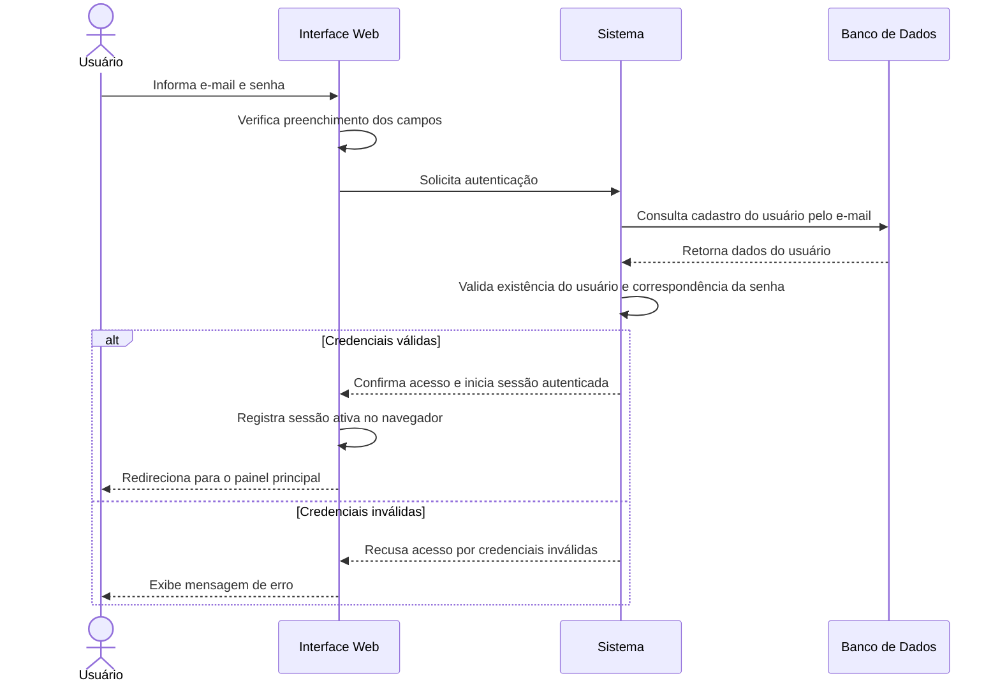
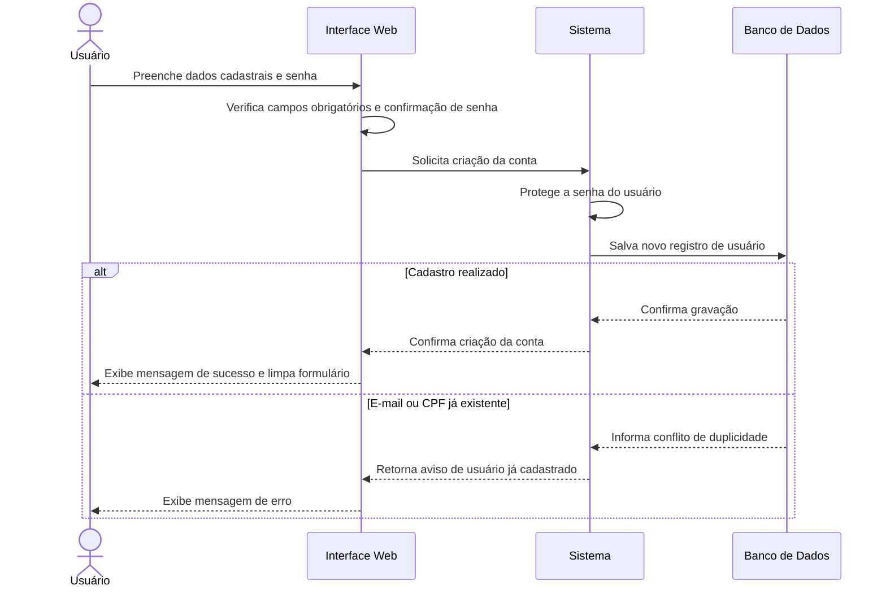
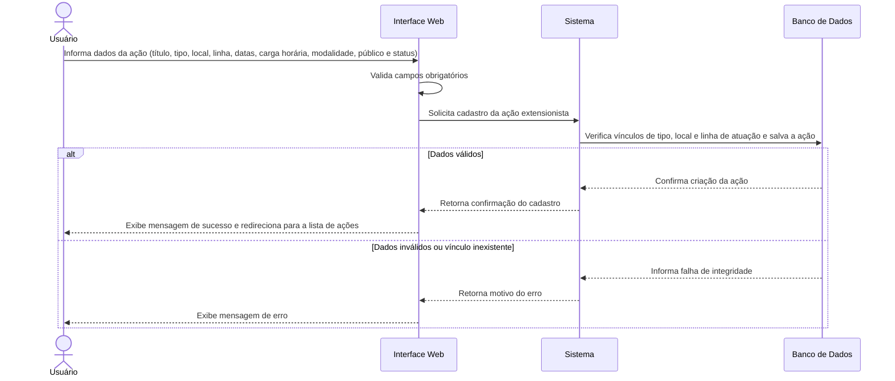
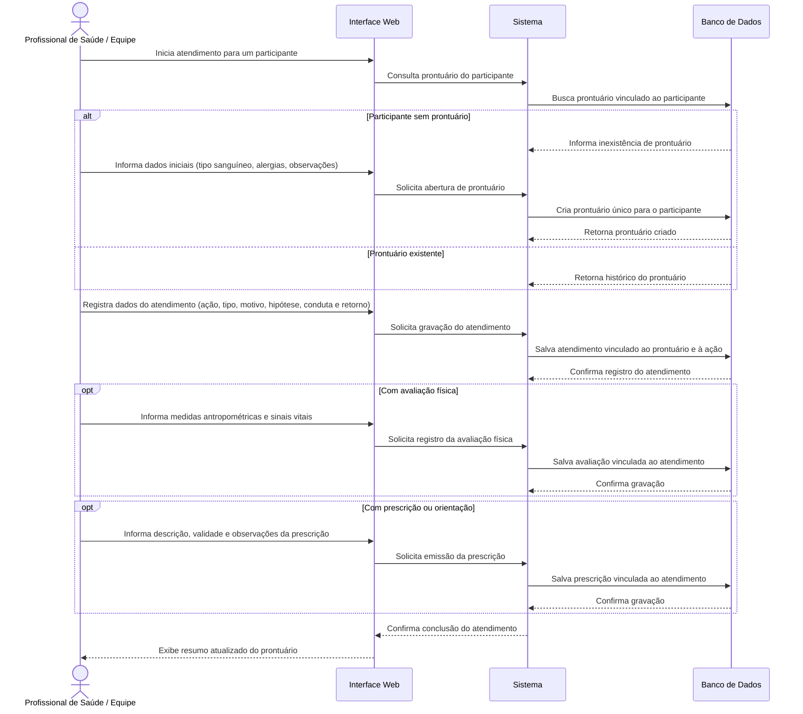

# Prontuário Extensionista - NJBV

Sistema de prontuário eletrônico extensionista desenvolvido para integrar dados das ações extensionistas realizadas pelo NJBV.

## Stack

| Camada                 | Tecnologia                                              |
| ---------------------- | ------------------------------------------------------- |
| Gerenciador de pacotes | [pnpm](https://pnpm.io/)                                |
| Monorepo               | [Turborepo](https://turbo.build/repo)                   |
| Backend                | [Fastify](https://fastify.dev/)                         |
| ORM                    | [Prisma 7](https://www.prisma.io/)                      |
| Banco de dados         | [PostgreSQL 17](https://www.postgresql.org/) via Docker |
| Frontend               | [Next.js](https://nextjs.org/)                          |
| Mobile                 | [Expo](https://expo.dev/) _(em breve)_                  |

## Estrutura

```
prontuario-extensionista/
├── apps/
│   ├── api/          # Fastify + Prisma (Backend)
│   └── web/          # Next.js (Frontend)
│   └── mobile/       # Expo (Mobile, em breve)
├── packages/
│   └── tsconfig/     # Configurações TypeScript compartilhadas
├── docker-compose.yml
├── pnpm-workspace.yaml
└── turbo.json
```

---

## Pré-requisitos

### Windows

- [Node.js](https://nodejs.org/) >= 24.16.0 LTS
- [pnpm](https://pnpm.io/installation) >= 9.x
- [Docker Desktop](https://www.docker.com/products/docker-desktop/) com WSL2

**Instalar WSL2** (necessário para o Docker Desktop):

```powershell
# PowerShell como Administrador
wsl --install
# Reinicie o computador após a instalação
```

**Instalar pnpm:**

```powershell
npm install -g pnpm
```

### Linux

- [Node.js](https://nodejs.org/) >= 24.16.0 LTS
- [pnpm](https://pnpm.io/installation) >= 9.x
- [Docker Engine](https://docs.docker.com/engine/install/) + [Docker Compose](https://docs.docker.com/compose/install/)

**Instalar pnpm:**

```bash
npm install -g pnpm
```

**Instalar Docker Engine (Ubuntu/Debian):**

```bash
curl -fsSL https://get.docker.com | sh
sudo usermod -aG docker $USER
# Faça logout e login para aplicar o grupo
```

---

## Configuração inicial

### 1. Clonar o repositório

```bash
git clone https://github.com/ythmxz/prontuario-extensionista.git
cd prontuario-extensionista
```

### 2. Instalar dependências

```bash
pnpm install
```

### 3. Configurar variáveis de ambiente

```bash
cp apps/api/.env.example apps/api/.env
```

Abra `apps/api/.env` e ajuste.

> **Windows:** Se você já tiver um PostgreSQL local instalado na porta padrão (`5432`), o Docker está configurado para usar a porta `5433` para evitar conflitos.

### 4. Subir o banco de dados

```bash
docker compose up -d
```

Verifique se o container está saudável:

```bash
docker compose ps
# STATUS deve mostrar "healthy"
```

### 5. Aplicar as migrations

```bash
pnpm --filter api exec prisma migrate dev
```

### 6. Gerar o Prisma Client

```bash
pnpm --filter api exec prisma generate
```

---

## Desenvolvimento

### Rodar todos os apps

```bash
pnpm dev
```

### Rodar apenas o backend

```bash
pnpm --filter api dev
```

O servidor estará disponível em `http://localhost:3333`.

### Rodar apenas o frontend

```bash
pnpm --filter web dev
```

---

## Banco de dados

### Comandos úteis

```bash
# Criar uma nova migration após alterar o schema
pnpm --filter @prontuario-extensionista/api exec prisma migrate dev --name nome_da_migration

# Abrir o Prisma Studio (interface visual do banco)
pnpm --filter @prontuario-extensionista/api exec prisma studio

# Gerar o client após alterações no schema
pnpm --filter @prontuario-extensionista/api exec prisma generate
```

### Gerenciar o container Docker

```bash
# Subir o banco
docker compose up -d

# Parar o banco (dados preservados)
docker compose down

# Parar o banco e apagar todos os dados
docker compose down -v

# Ver logs do container
docker compose logs postgres
```

> **Atenção:** `docker compose down -v` apaga todos os dados do banco. Após rodar esse comando, execute `prisma migrate dev` novamente para recriar as tabelas.

---

## Build

```bash
# Build de todos os apps
pnpm build

# Build apenas do backend
pnpm --filter @prontuario-extensionista/api build
```

---

## Notas importantes

- O arquivo `.env` **não é versionado**. Use `.env.example` como referência.
- Ao atualizar o `schema.prisma`, sempre rode `prisma migrate dev` seguido de `prisma generate`.
- O Turborepo faz cache dos builds — se algo parecer desatualizado, rode `pnpm build --force`.

## Requisitos

### Requisitos Funcionais (RF)

Os requisitos funcionais apresentados a seguir foram identificados a partir da análise dos modelos de dados, rotas da API e páginas do frontend do sistema.

| ID | Módulo | Requisito Funcional |
|:---:|---|---|
| RF01 | Autenticação | O sistema deve permitir que usuários realizem login utilizando e-mail e senha, retornando um token JWT com validade de 1 hora e os dados básicos do usuário. |
| RF02 | Autenticação | O sistema deve permitir o cadastro de novos operadores (`User`), contendo nome, e-mail único, CPF único, telefone e senha, com confirmação de senha no frontend. |
| RF03 | Autenticação | O sistema deve oferecer autenticação e cadastro federado por meio de uma conta Google. |
| RF04 | Estrutura Acadêmica | O sistema deve permitir o CRUD completo de Departamentos, Colegiados vinculados a departamentos e Cursos (Graduação, Especialização, Mestrado e Doutorado). |
| RF05 | Estrutura Acadêmica | O sistema deve permitir o cadastro e a manutenção de Alunos (matrícula, período atual, situação acadêmica e data de ingresso) e Professores (matrícula e vínculo), associados a uma `Pessoa`. |
| RF06 | Núcleo e Extensão | O sistema deve permitir o cadastro e a consulta de Núcleos (com resolução CONSEPE e data de aprovação), Linhas de Atuação, Tipos de Ação e Locais de Ação (Escola, UBS, Campus, Comunidade e Outros). |
| RF07 | Pessoas | O sistema deve manter um cadastro único de Pessoas, contendo CPF (11 dígitos e único), nome, data de nascimento, sexo (`M`, `F`, `OUTRO`), contatos e endereço completo. |
| RF08 | Equipe Extensionista | O sistema deve permitir cadastrar uma `Pessoa` como Membro da Equipe, classificando seu tipo (`COORDENADOR`, `DOCENTE`, `DISCENTE`, `VOLUNTARIO`, `TECNICO`), departamento, matrícula e vínculo. |
| RF09 | Equipe Extensionista | O sistema deve permitir vincular membros da equipe a ações extensionistas (`EquipeAcao`), especificando papel, data de entrada, data de saída opcional e horas dedicadas, impedindo vínculos duplicados do mesmo membro na mesma ação. |
| RF10 | Ações Extensionistas | O sistema deve permitir cadastrar e listar Ações Extensionistas, contendo título, descrição, tipo, local, linha de atuação (opcional no banco), datas de início e término, carga horária, modalidade (`PRESENCIAL`, `REMOTO`, `HIBRIDO`), público-alvo e status (`PLANEJADA`, `EM_ANDAMENTO`, `CONCLUIDA`, `CANCELADA`). |
| RF11 | Documentos | O sistema deve permitir associar Documentos (`RELATORIO`, `MATERIAL_EDUCATIVO`, `FOTO`, `VIDEO`, `OUTRO`) às ações extensionistas, contendo título, tipo e URL do arquivo, além de disponibilizar sua listagem. |
| RF12 | Participantes | O sistema deve permitir consultar Participantes da comunidade, incluindo dados pessoais, escolaridade e informações do responsável, separando automaticamente os participantes de ações em andamento daqueles pertencentes ao histórico de ações concluídas, com filtros por nome, CPF ou e-mail. |
| RF13 | Participações | O sistema deve permitir registrar e listar a Participação e Frequência dos participantes nas ações extensionistas, utilizando os estados (`PRESENTE`, `AUSENTE`, `JUSTIFICADO`), com data e observações. |
| RF14 | Prontuário Eletrônico | O sistema deve manter um Prontuário único por participante (relacionamento 1:1), contendo número do prontuário, data de abertura, tipo sanguíneo, alergias e observações gerais. |
| RF15 | Atendimento Clínico | O sistema deve permitir registrar Atendimentos vinculados a um prontuário, uma ação extensionista e um profissional (`MembroEquipe`), registrando tipo (`CONSULTA`, `TRIAGEM`, `ORIENTACAO`, `ACOMPANHAMENTO`, `OUTRO`), motivo, hipótese diagnóstica, conduta e retorno previsto. |
| RF16 | Avaliação Física | O sistema deve permitir registrar uma Avaliação Física vinculada ao atendimento (relacionamento 1:1), contemplando peso (kg), altura (cm), IMC, pressão arterial, frequência cardíaca, temperatura e saturação de O₂. |
| RF17 | Prescrição | O sistema deve permitir emitir Prescrições vinculadas a um atendimento, contendo descrição, data de validade e observações. |
| RF18 | Dashboard e Agenda | O sistema deve apresentar um painel inicial (`/dashboard`) com métricas consolidadas (pessoas atendidas, atendimentos do dia, ações comunitárias e prontuários), gráfico semanal e uma tela de Agenda (`/agenda`) para organização de consultas e retornos. |
| RF19 | Relatórios | O sistema deve disponibilizar uma visão de Relatórios (`/relatorios`) com evolução temporal da participação comunitária, indicadores percentuais (atendimentos, retornos, participação e acompanhamentos) e resumo mensal. |
| RF20 | Configurações | O sistema deve permitir que o usuário visualize e edite dados de perfil, altere sua senha e configure preferências de notificações e aparência, como modo escuro e layout compacto. |


### Requisitos Não Funcionais (RNF)

Os requisitos não funcionais foram classificados conforme as características de qualidade de software estabelecidas pela norma ISO/IEC 25010, considerando aspectos técnicos evidenciados na arquitetura e no código-fonte do projeto.

| ID | Categoria | Descrição do Requisito Não Funcional |
|:---:|---|---|
| RNF01 | Segurança (Criptografia) | As senhas dos usuários nunca devem ser armazenadas em texto plano, devendo ser processadas com hash criptográfico utilizando `bcryptjs`, com fator de custo (*salt rounds*) igual a `10`. |
| RNF02 | Segurança (Autenticação e Sessão) | A autenticação da API deve ser *stateless*, utilizando tokens JWT com tempo de expiração definido em `1h`. Além disso, as rotas privadas do frontend devem verificar a presença de sessão antes de renderizar conteúdo (`ProtectedArea`). |
| RNF03 | Segurança (Configuração) | As credenciais do banco de dados e as chaves secretas de assinatura JWT devem ser gerenciadas por meio de variáveis de ambiente (`DATABASE_URL`, `JWT_SECRET`), evitando sua exposição no código-fonte de produção. |
| RNF04 | Usabilidade e Responsividade | As interfaces de entrada (Login e Cadastro) devem adaptar-se a diferentes resoluções de tela (desktops, tablets e smartphones), possuindo regras específicas para *breakpoints* de `900px`, `600px` e `380px`. |
| RNF05 | Usabilidade e Acessibilidade | Os formulários devem fornecer feedback visual claro e acessível para estados de carregamento, sucesso e erro, utilizando regiões `aria-live="polite"` e bloqueando submissões duplicadas por meio do atributo `disabled` durante as requisições. |
| RNF06 | Integridade de Dados | O banco de dados PostgreSQL deve garantir integridade referencial por meio de chaves estrangeiras (`ON DELETE RESTRICT` / `SET NULL`) e restrições de unicidade para campos como `cpf`, `email`, `matricula`, `numeroProntuario` e a combinação `[membroId, acaoId]`. |
| RNF07 | Confiabilidade e Tratamento de Erros | A API deve interceptar erros conhecidos do ORM Prisma (`P2002` conflito/duplicidade → HTTP 409; `P2003` chave estrangeira → HTTP 400; `P2014` relação vinculada → HTTP 409; `P2025` registro não encontrado → HTTP 404), retornando mensagens legíveis em português. |
| RNF08 | Manutenibilidade e Padronização | O código-fonte deve utilizar TypeScript em modo estrito (`strict: true`) tanto no frontend quanto no backend, centralizando operações CRUD repetitivas em um módulo genérico (`setupCrudRoutes`) e realizando a sanitização de strings (`trimmedStringFieldConfig`). |
| RNF09 | Evolução de Esquema | Todas as alterações estruturais no banco de dados devem ser versionadas por meio de migrações SQL rastreáveis e acompanhadas de um script automatizado de carga inicial (*seed*) para ambientes de desenvolvimento e teste. |
| RNF10 | Desempenho | Telas que dependem de múltiplas entidades relacionais (como Equipe, Membros e Participações) devem realizar requisições concorrentes à API utilizando `Promise.all`, minimizando a latência durante o carregamento das informações. |
| RNF11 | Interoperabilidade | A comunicação entre frontend e backend deve ocorrer por meio do protocolo HTTP/REST, utilizando payloads no formato JSON e suporte a CORS habilitado no servidor Fastify. |
| RNF12 | Disponibilidade e Monitoramento | A API deve disponibilizar um endpoint dedicado de verificação de saúde (`/health`), retornando o status operacional do serviço para possibilitar o monitoramento de sua disponibilidade. |

# Diagramas

## Casos de Uso


## Diagramas de Sequência

### Autenticação de Usuário



### Cadastro de Novo Usuário



### Cadastro de Ação Extensionista



### Atendimento Clínico e Registro no Prontuário


