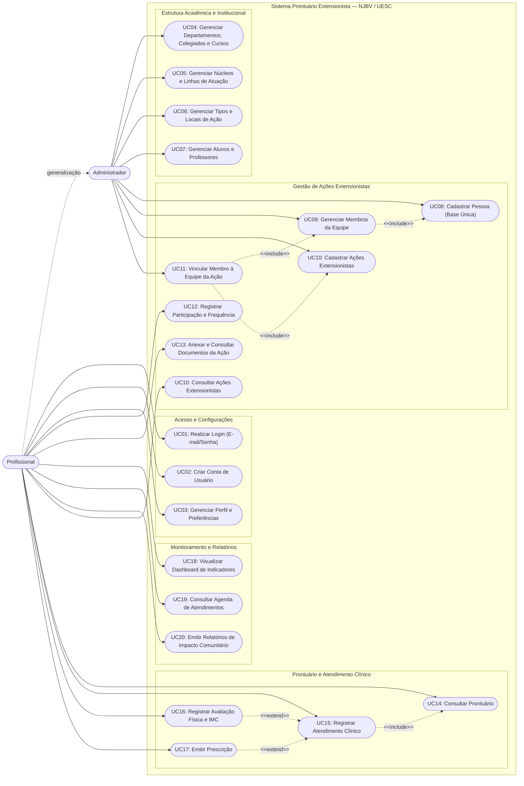

# Prontuário Extensionista - NJBV

Sistema de prontuário eletrônico extensionista desenvolvido para integrar dados das ações extensionistas realizadas pelo NJBV.

## Stack

| Camada                 | Tecnologia                                              |
| ---------------------- | ------------------------------------------------------- |
| Gerenciador de pacotes | [pnpm](https://pnpm.io/)                                |
| Monorepo               | [Turborepo](https://turbo.build/repo)                   |
| Backend                | [Fastify](https://fastify.dev/)                         |
| ORM                    | [Prisma 7](https://www.prisma.io/)                      |
| Banco de dados         | [PostgreSQL 17](https://www.postgresql.org/) via Docker |
| Frontend               | [Next.js](https://nextjs.org/)                          |
| Mobile                 | [Expo](https://expo.dev/) _(em breve)_                  |

## Estrutura

```
prontuario-extensionista/
├── apps/
│   ├── api/          # Fastify + Prisma (Backend)
│   └── web/          # Next.js (Frontend)
│   └── mobile/       # Expo (Mobile, em breve)
├── packages/
│   └── tsconfig/     # Configurações TypeScript compartilhadas
├── docker-compose.yml
├── pnpm-workspace.yaml
└── turbo.json
```

---

## Pré-requisitos

### Windows

- [Node.js](https://nodejs.org/) >= 24.16.0 LTS
- [pnpm](https://pnpm.io/installation) >= 9.x
- [Docker Desktop](https://www.docker.com/products/docker-desktop/) com WSL2

**Instalar WSL2** (necessário para o Docker Desktop):

```powershell
# PowerShell como Administrador
wsl --install
# Reinicie o computador após a instalação
```

**Instalar pnpm:**

```powershell
npm install -g pnpm
```

### Linux

- [Node.js](https://nodejs.org/) >= 24.16.0 LTS
- [pnpm](https://pnpm.io/installation) >= 9.x
- [Docker Engine](https://docs.docker.com/engine/install/) + [Docker Compose](https://docs.docker.com/compose/install/)

**Instalar pnpm:**

```bash
npm install -g pnpm
```

**Instalar Docker Engine (Ubuntu/Debian):**

```bash
curl -fsSL https://get.docker.com | sh
sudo usermod -aG docker $USER
# Faça logout e login para aplicar o grupo
```

---

## Configuração inicial

### 1. Clonar o repositório

```bash
git clone https://github.com/ythmxz/prontuario-extensionista.git
cd prontuario-extensionista
```

### 2. Instalar dependências

```bash
pnpm install
```

### 3. Configurar variáveis de ambiente

```bash
cp apps/api/.env.example apps/api/.env
```

Abra `apps/api/.env` e ajuste.

> **Windows:** Se você já tiver um PostgreSQL local instalado na porta padrão (`5432`), o Docker está configurado para usar a porta `5433` para evitar conflitos.

### 4. Subir o banco de dados

```bash
docker compose up -d
```

Verifique se o container está saudável:

```bash
docker compose ps
# STATUS deve mostrar "healthy"
```

### 5. Aplicar as migrations

```bash
pnpm --filter api exec prisma migrate dev
```

### 6. Gerar o Prisma Client

```bash
pnpm --filter api exec prisma generate
```

---

## Desenvolvimento

### Rodar todos os apps

```bash
pnpm dev
```

### Rodar apenas o backend

```bash
pnpm --filter api dev
```

O servidor estará disponível em `http://localhost:3333`.

### Rodar apenas o frontend

```bash
pnpm --filter web dev
```

---

## Banco de dados

### Comandos úteis

```bash
# Criar uma nova migration após alterar o schema
pnpm --filter @prontuario-extensionista/api exec prisma migrate dev --name nome_da_migration

# Abrir o Prisma Studio (interface visual do banco)
pnpm --filter @prontuario-extensionista/api exec prisma studio

# Gerar o client após alterações no schema
pnpm --filter @prontuario-extensionista/api exec prisma generate
```

### Gerenciar o container Docker

```bash
# Subir o banco
docker compose up -d

# Parar o banco (dados preservados)
docker compose down

# Parar o banco e apagar todos os dados
docker compose down -v

# Ver logs do container
docker compose logs postgres
```

> **Atenção:** `docker compose down -v` apaga todos os dados do banco. Após rodar esse comando, execute `prisma migrate dev` novamente para recriar as tabelas.

---

## Build

```bash
# Build de todos os apps
pnpm build

# Build apenas do backend
pnpm --filter @prontuario-extensionista/api build
```

---

## Notas importantes

- O arquivo `.env` **não é versionado**. Use `.env.example` como referência.
- Ao atualizar o `schema.prisma`, sempre rode `prisma migrate dev` seguido de `prisma generate`.
- O Turborepo faz cache dos builds — se algo parecer desatualizado, rode `pnpm build --force`.

## Diagramas

### Casos de Uso


